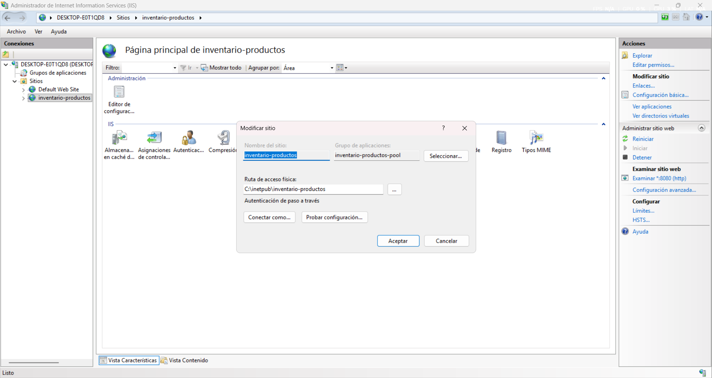
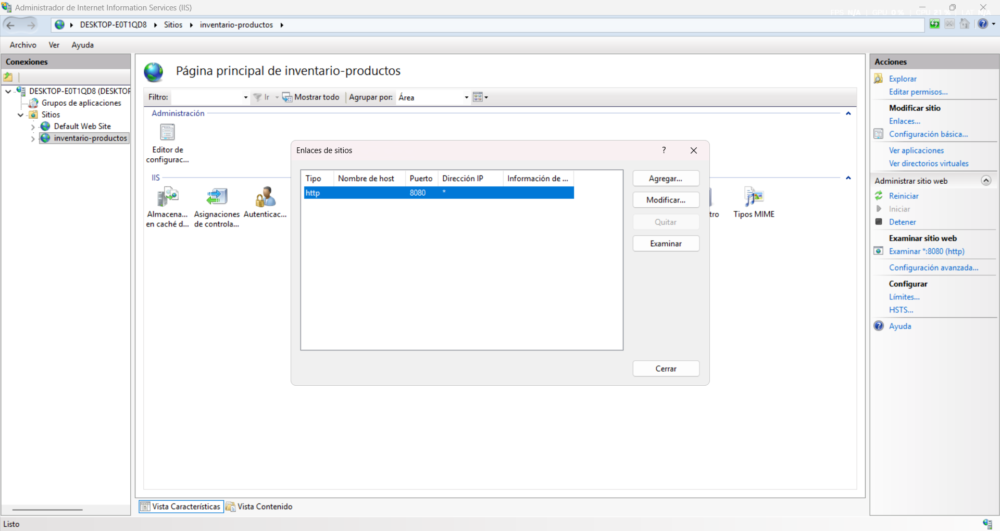
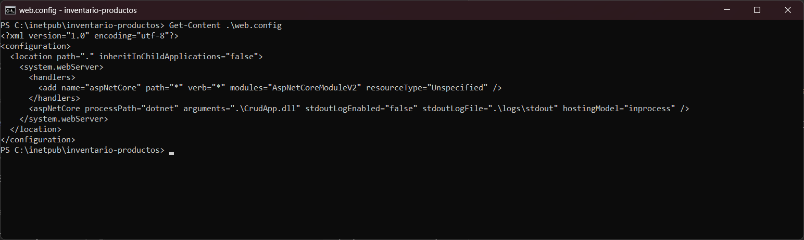
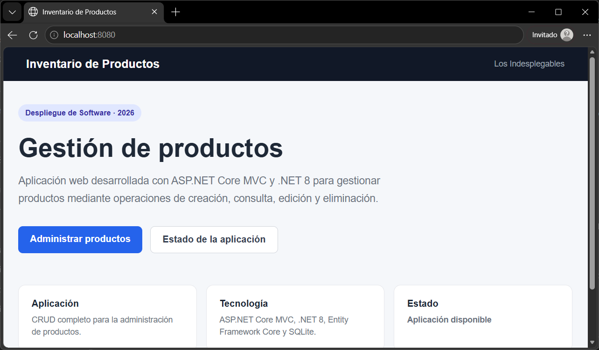
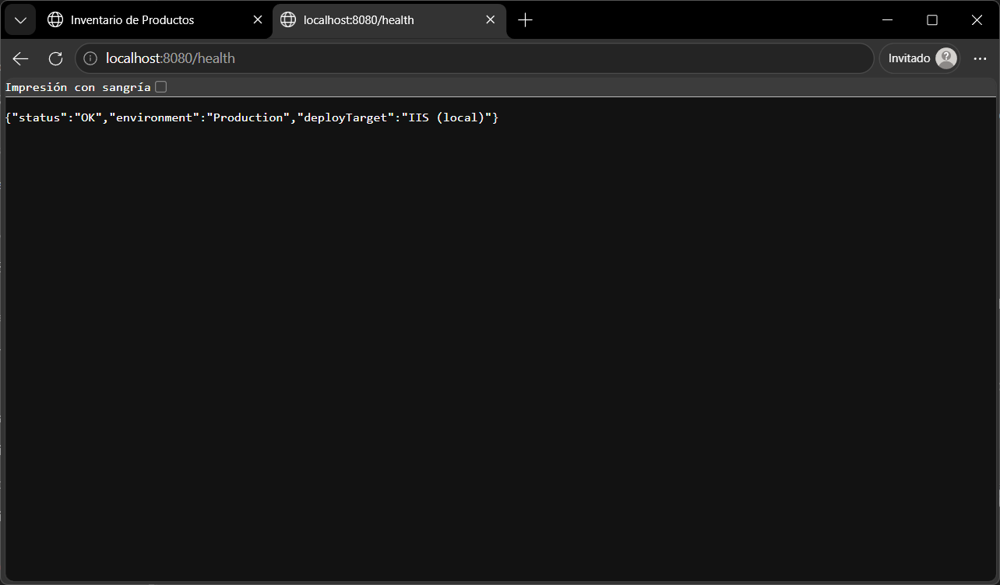
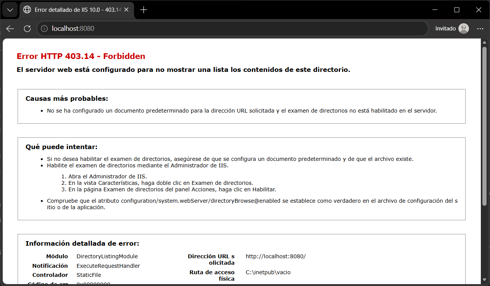
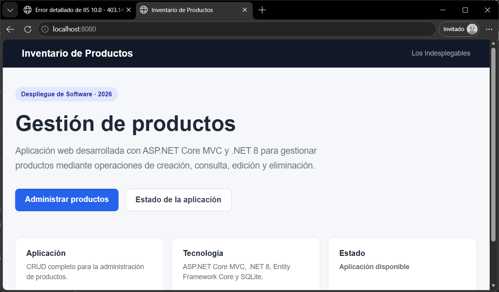

# Inventario de Productos

Aplicación web para la gestión de productos mediante operaciones CRUD (crear, consultar, editar y eliminar), desarrollada con ASP.NET Core MVC sobre .NET 8.

Este proyecto será utilizado por el equipo Los Indesplegables para realizar la publicación y verificación de la aplicación en IIS y Azure App Service.

## Equipo

**Los Indesplegables**

| Integrante | Responsabilidad principal |
| --- | --- |
| Juliana Arenas Arias | Preparación de la aplicación, endpoint /health, configuración por entorno e integración continua |
| Oscar Alexis Pineda Henao | IIS: instalación, Hosting Bundle, publicación y Application Pool |
| Heyner Mena Campaña | IIS: sitio, puerto, punto de entrada, verificación y solución de problemas |
| Camilo Ospina Hernández | Azure: creación de recursos y publicación en App Service |
| Juan Andres Ramirez Castañeda | Azure: Application Settings, HTTPS Only y verificación pública |

## Tecnología utilizada

- ASP.NET Core MVC
- .NET 8
- C#
- Entity Framework Core
- SQLite
- Bootstrap
- IIS
- Azure App Service
- GitHub Actions

## Funcionalidad

La aplicación permite:

- Consultar productos.
- Crear nuevos productos.
- Editar productos existentes.
- Consultar el detalle de un producto.
- Eliminar productos.
- Validar la disponibilidad de la aplicación mediante `/health`.

## Estructura del repositorio

```text
inventario-productos/
├── Controllers/
├── Data/
├── Migrations/
├── Models/
├── Views/
├── deploy/
│   ├── iis/
│   └── azure/
├── evidencias/
│   ├── iis/
│   └── azure/
├── Program.cs
├── CrudApp.csproj
├── appsettings.json
└── README.md
cat > README.md <<'EOF'
# Inventario de Productos

Aplicación web para la gestión de productos mediante operaciones CRUD (crear, consultar, editar y eliminar), desarrollada con ASP.NET Core MVC sobre .NET 8.

Este proyecto será utilizado por el equipo Los Indesplegables para realizar la publicación y verificación de la aplicación en IIS y Azure App Service.

## Equipo

**Los Indesplegables**

| Integrante | Responsabilidad principal |
| --- | --- |
| Juliana Arenas Arias | Preparación de la aplicación, endpoint /health, configuración por entorno e integración continua |
| Oscar Alexis Pineda Henao | IIS: instalación, Hosting Bundle, publicación y Application Pool |
| Heyner Mena Campaña | IIS: sitio, puerto, punto de entrada, verificación y solución de problemas |
| Camilo Ospina Hernández | Azure: creación de recursos y publicación en App Service |
| Juan Andres Ramirez Castañeda | Azure: Application Settings, HTTPS Only y verificación pública |

## Tecnología utilizada

- ASP.NET Core MVC
- .NET 8
- C#
- Entity Framework Core
- SQLite
- Bootstrap
- IIS
- Azure App Service
- GitHub Actions

## Funcionalidad

La aplicación permite:

- Consultar productos.
- Crear nuevos productos.
- Editar productos existentes.
- Consultar el detalle de un producto.
- Eliminar productos.
- Validar la disponibilidad de la aplicación mediante `/health`.

## Estructura del repositorio

```text
inventario-productos/
├── Controllers/
├── Data/
├── Migrations/
├── Models/
├── Views/
├── deploy/
│   ├── iis/
│   └── azure/
├── evidencias/
│   ├── iis/
│   └── azure/
├── Program.cs
├── CrudApp.csproj
├── appsettings.json
└── README.md


## Publicación en IIS · Sitio y verificación

**Responsable:** Heyner Mena Campaña · **Fecha:** 31/10/2026

Esta parte toma la aplicación publicada y el Application Pool que dejó listos Alexis (carpeta `C:\inetpub\inventario-productos` y grupo `inventario-productos-pool`), crea el sitio en IIS, lo deja respondiendo en un puerto propio y verifica la aplicación en local. Los pasos están en [`deploy/iis/crear-sitio-iis.ps1`](deploy/iis/crear-sitio-iis.ps1).

### Sitio y enlace

| Elemento | Valor |
| --- | --- |
| Nombre del sitio | `inventario-productos` |
| Grupo de aplicaciones | `inventario-productos-pool` |
| Ruta física | `C:\inetpub\inventario-productos` |
| Enlace | `http`, IP «Todas las no asignadas», puerto **8080**, nombre de host vacío |
| URL de la aplicación | http://localhost:8080 |
| URL de verificación | http://localhost:8080/health |

Antes de crear el sitio se comprobó con `netstat -ano | findstr :8080` que el puerto estuviera libre (sin resultados).





### Punto de entrada (`web.config`)

`dotnet publish` genera un `web.config` en la carpeta publicada. Su etiqueta `aspNetCore` es el punto de entrada: le dice a IIS cómo arrancar la aplicación y le entrega todas las peticiones.

```xml
<aspNetCore processPath="dotnet" arguments=".\CrudApp.dll" stdoutLogEnabled="false" stdoutLogFile=".\logs\stdout" hostingModel="inprocess" />
```

| Atributo | Valor | Qué significa |
| --- | --- | --- |
| `processPath` | `dotnet` | Programa que ejecuta la aplicación (el runtime de .NET) |
| `arguments` | `.\CrudApp.dll` | Ensamblado de la aplicación que arranca |
| `hostingModel` | `inprocess` | La app corre dentro del proceso de IIS (`w3wp.exe`), sin servidor Kestrel aparte |

IIS no sirve las páginas por sí mismo: el módulo ASP.NET Core (`AspNetCoreModuleV2`) recibe cada petición y la pasa a la aplicación, que sirve `wwwroot/index.html` en «/» gracias a `UseDefaultFiles()` y `UseStaticFiles()`.



### Verificación

| URL | Respuesta esperada |
| --- | --- |
| http://localhost:8080 | Página inicial de Inventario de Productos |
| http://localhost:8080/health | `{"status":"OK","environment":"Production","deployTarget":"IIS (local)"}` |

`environment` es `Production` porque IIS no define `ASPNETCORE_ENVIRONMENT`, y `deployTarget` viene de `appsettings.json`; en Azure ese valor se sobrescribe con un Application Setting.





### Solución de problemas

| Síntoma | Causa probable | Solución |
| --- | --- | --- |
| Error 500.19 | Falta el Hosting Bundle o el `web.config` es inválido | Instalar el Hosting Bundle y reiniciar IIS (`net stop was /y` y `net start w3svc`) |
| Error 500.30 / 500.31 | La app no arranca o falta el runtime de .NET | Activar `stdoutLogEnabled="true"` en `web.config`, crear la carpeta `logs` y leer el log; desactivarlo al terminar |
| Error 403.14 | La ruta física no apunta a la carpeta publicada | Corregir la ruta del sitio |
| 404 en «/» | La app no tiene página inicial | Revisar `wwwroot/index.html` y `UseDefaultFiles()` |
| El sitio no inicia | Puerto ocupado | Cambiar el enlace a otro puerto |
| Acceso denegado | Permisos de la carpeta | Agregar `IIS AppPool\inventario-productos-pool` a la carpeta |
| 500.30 con SQLite (propio de esta app) | La app crea `app.db` al iniciar y el Application Pool no puede escribir en la carpeta | Dar al Application Pool permiso de **Modificar**, no solo lectura |

Para republicar, detener primero el Application Pool (evita archivos bloqueados) y volver a iniciarlo al terminar.

### Problema encontrado en nuestro despliegue

Para documentar el error más común de la tabla, reprodujimos **a propósito** el **HTTP Error 403.14 - Forbidden**: cambiamos la *Ruta de acceso física* del sitio a una carpeta vacía (`C:\inetpub\vacio`) y recargamos http://localhost:8080. IIS respondió 403.14 (módulo `DirectoryListingModule`) porque en esa carpeta no hay documento predeterminado ni `web.config` y el listado de directorios está desactivado.



Se resolvió corrigiendo la ruta física del sitio a `C:\inetpub\inventario-productos`. Tras recargar, la aplicación y `/health` volvieron a responder.



## Publicación en Azure · Recursos y publicación

**Responsable:** Camilo Ospina Hernández · **Fecha de publicación:** 31/10/2026

### Recursos creados

| Elemento | Valor |
| --- | --- |
| Suscripción | Azure for Students |
| Grupo de recursos | `rg-inventario-productos` |
| App Service | `inventario-productos-itm` |
| Plan de App Service | `plan-inventario` · Free F1 · Windows |
| Región | Brazil South |
| Pila | .NET 8 (LTS) |
| URL pública | https://inventario-productos-itm-gnf0fresfydyhrgg.brazilsouth-01.azurewebsites.net |

El acceso de Juan Andrés Ramírez se dio con el rol **Colaborador** en el grupo de recursos (Control de acceso IAM), sin compartir contraseñas.

### Publicación

Se publicó con Azure CLI y despliegue zip (OneDeploy). Los comandos están en [`deploy/azure/publicar.ps1`](deploy/azure/publicar.ps1):

```powershell
az login
az account set --subscription "Azure for Students"
dotnet publish -c Release -o publish
Compress-Archive -Path publish\* -DestinationPath app.zip -Force
az webapp deploy --resource-group rg-inventario-productos --name inventario-productos-itm --src-path app.zip --type zip
```

Resultado: `provisioningState: Succeeded`. La verificación inmediata de `/health` respondió `{"status":"OK","environment":"Production","deployTarget":"IIS (local)"}`; el valor `IIS (local)` viene de `appsettings.json` y se reemplaza en Azure con el Application Setting que configura Juan.

App Service en Windows también corre sobre IIS, administrado por Azure: la respuesta HTTP incluye `Server: Microsoft-IIS/10.0`.

### Problemas encontrados y solución

| Problema | Causa | Solución |
| --- | --- | --- |
| `Resource was disallowed by Azure` al crear en South Central US y East US | La suscripción Azure for Students tiene la política `sys.regionrestriction`, que solo permite westus2, brazilsouth, spaincentral, northcentralus y francecentral | Consultar la política con `az policy assignment show --name sys.regionrestriction --query parameters` y elegir una región permitida |
| `Operation cannot be completed without additional quota (F1 VMs): 0` | La cuota del plan gratuito F1 es 0 en algunas regiones permitidas | Probar otra región permitida; en **Brazil South** sí había cuota F1 |
| `SubscriptionNotFound` al desplegar | La CLI tenía guardada una suscripción distinta | `az login` y seleccionar *Azure for Students* (`az account set`) |

### Evidencias (`evidencias/azure/`)

| Archivo | Qué muestra |
| --- | --- |
| `01-grupo-recursos.png` | Grupo de recursos `rg-inventario-productos` creado en Azure for Students |
| `02-plan-app-service.png` | Plan `plan-inventario`: Brazil South, Windows, Free F1 |
| `02a-intento-east-us.png` | Primer intento de creación en East US, bloqueado por la política de regiones |
| `03-app-service-overview.png` | App Service en ejecución: grupo, región, plan F1, .NET 8 y URL |
| `04-publicacion-exitosa.png` | Página inicial cargando en la URL pública de Azure |
| `04a-crud-listado-azure.png` | Listado de productos funcionando en Azure (escritura en SQLite) |
| `04b-crud-crear-producto-azure.png` | Formulario de creación de producto en Azure |
